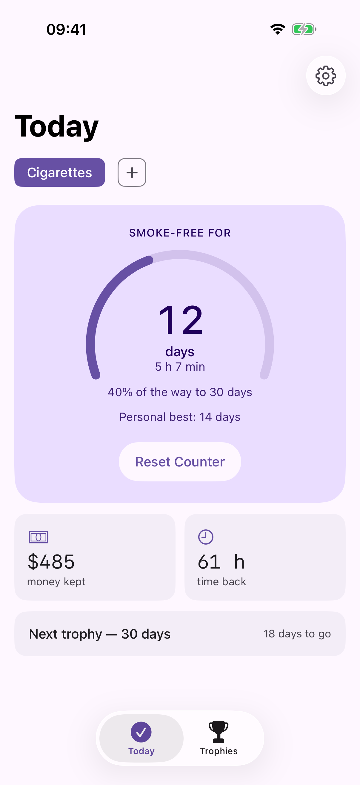
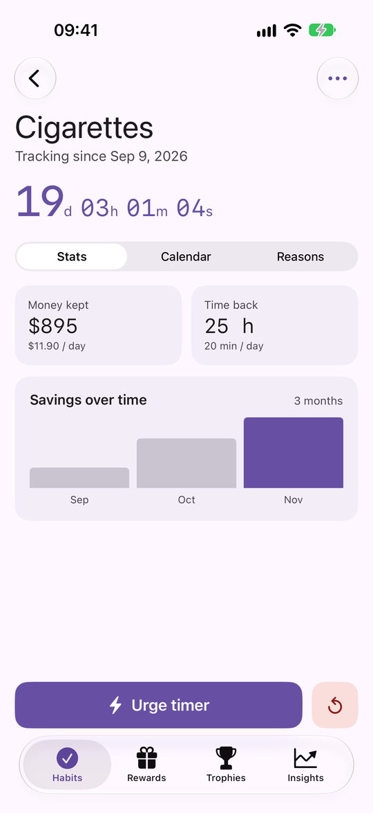
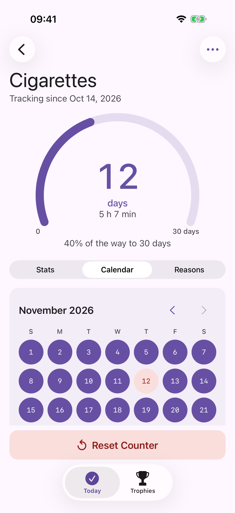
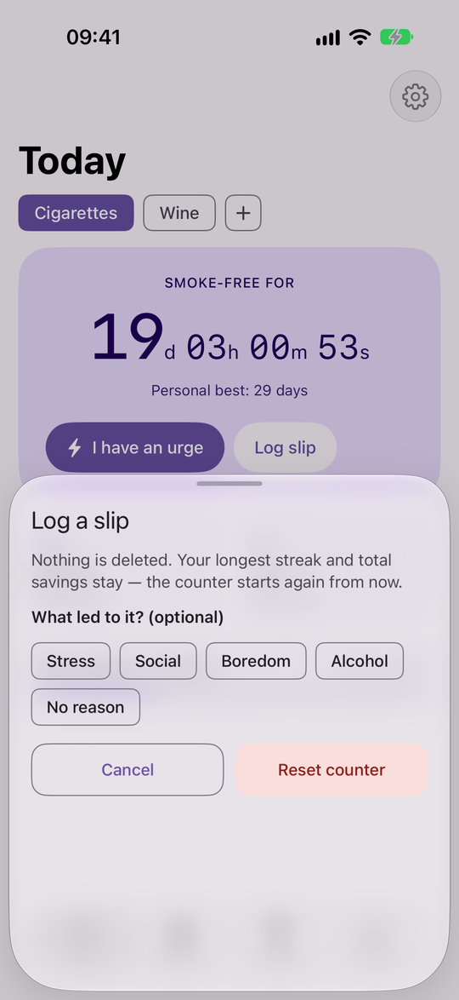
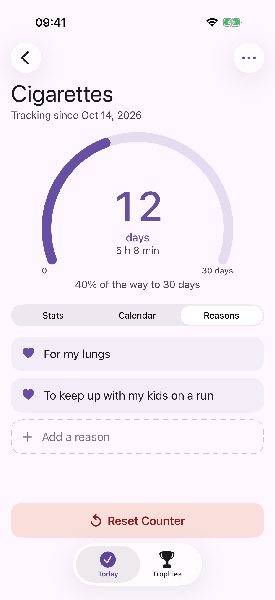
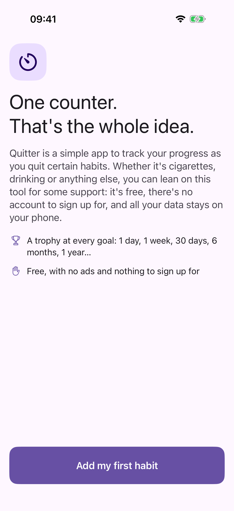
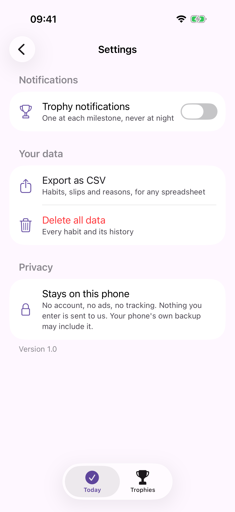
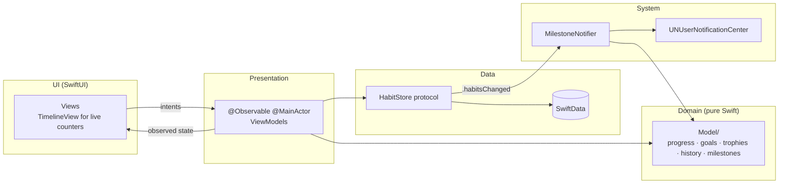

# Quitter for iOS

**One counter. That's the whole idea.**

Your last cigarette, drink or bet starts the clock. Quitter shows how long you've held out, the money you didn't spend and the time you got back, for smoking, alcohol, sugar, vaping, social media or gambling. No account, no ads, no tracking: everything stays on your iPhone.


<p align="center">
  
  
  
</p>

> The Android app, built natively in Kotlin and Jetpack Compose with the same features, lives in [quitter-android](https://github.com/devArthur4718/quitter-android).

---

## Why Quitter is different

- **Private by design.** No account, no server, no analytics, no ads, and no networking code at all — the app has nothing that could send your data anywhere. Your iPhone's own backup can keep a copy, so a new phone doesn't cost you your streak.
- **A slip is not a failure.** Logging a slip restarts the counter, but your longest streak and all the money and time you've saved are kept. The wording never shames.
- **Notifications that respect you.** Opt-in trophy notifications at every goal — 1 day, 1 week, 30, 60 and 90 days, 6 months, 1 year, 1½ years, 2 years, then every year, plus your own personal goals — and never between 22:00 and 08:00.

## Features

| | |
|---|---|
| **Today** — a live counter per habit inside a progress arc that fills up to the next goal, money kept, time back, personal best, and progress to the next trophy. | **Reset Counter** — log a slip with an optional trigger (stress, social, boredom…); your best streak and savings are kept. |
|  |  |
| **Stats** — money kept and time back across every streak, and a six-month savings chart. | **Calendar** — every day since you started, clean or slip, month by month. |
|  |  |
| **Reasons** — why you're quitting, in your own words. | **Trophies** — every trophy on the ladder (1 day, 1 week, 30, 60, 90 days, 6 months, 1 year, 1½ years, 2 years, then every year), earned with the date your best streak reached it, the next one highlighted, and personal goals with your own name ("Beach trip, 45 days"). |
|  | |
| **Welcome** — no sign-up; one tap to your first habit. | **Settings** — trophy notifications, CSV export through the share sheet, delete all data. |
|  |  |

Two tabs: **Today · Trophies**. Also: several habits at once, edit or delete a habit, an empty state when the last habit is gone, and English, Brazilian Portuguese and Spanish — including dates, plurals and currency.

## Architecture

MVVM with `@Observable` ViewModels. Views stay declarative; ViewModels own state and intents and report navigation through closures, so they're testable without SwiftUI.



**Layers**

- **`Model/`** — the rules of the app as plain Swift values: how a slip keeps the time of the streak it ends, money and time saved, the goal ladder (trophies and the progress arc), the calendar month, the savings chart and notification timing. Time and calendar are always passed in, so every rule is tested with fixed dates and time zones.
- **`Data/`** — SwiftData models behind a `HabitStore` protocol. ViewModels never see SwiftData, and tests use the same store in memory. A slip updates the habit and records the slip in one save.
- **Feature folders** (`Home/`, `Trophies/`, `Detail/`, `Settings/`, …) — each a View plus its ViewModel. Navigation is a typed `Route` enum on a `NavigationStack`.
- **`Notifications/`** — trophy notifications, re-planned whenever habits change (see below).

**Decisions worth noting**

| Decision | Why |
|---|---|
| A slip keeps the streak's time instead of erasing it | Money kept and time back keep growing across slips; the longest streak is kept. Quitting is rarely a straight line, and the app shouldn't punish honesty. |
| Live counters tick with `TimelineView`, not timers in ViewModels | ViewModels hold *when* the streak started and compute elapsed time for any date; the view asks once a second. Nothing to cancel, nothing to leak, trivially testable. |
| Versioned SwiftData schemas (V1 → V3) with a migration plan, each step tested | Updates never lose data: V2 added personal goals, V3 dropped the removed urge timer's records. |
| Trophy notifications are **booked ahead**: up to 8 per habit, 60 in total, nearest first | iOS can't run the app when a notification fires, and keeps at most 64 pending per app. The plan is redone after any add, slip, edit or delete (the store posts `.habitsChanged`) and each time the app comes to the front. |
| Quiet hours (22:00 → 08:00) in the domain model | A trophy reached at 03:00 is delivered at 08:00 local time — and still delivered if the plan is redone at 05:00. |
| Swift 6 language mode | Strict concurrency checking: ViewModels are `@MainActor`, pure planning code is `nonisolated`. |

## Tech stack

| | |
|---|---|
| Language | Swift 6 (strict concurrency) |
| UI | SwiftUI, SF Symbols, Dynamic Type, light and dark colour sets |
| State | Observation (`@Observable`) |
| Persistence | SwiftData |
| Notifications | UserNotifications, with foreground presentation |
| Localization | String Catalog (`Localizable.xcstrings`) |
| Minimum OS | iOS 17 |
| Tests | Swift Testing, XCUITest |

## Project structure

```
Quitter/
├── App/            App entry, Route, RootView, feature flags
├── Model/          Pure rules: Habit, HabitProgress, Goals, PersonalGoal, Trophies, HabitHistory, Milestones
├── Data/           SwiftData records, HabitStore, CSV export
├── Notifications/  MilestoneNotifier and the MilestoneNotifying protocol
├── Onboarding/     Welcome
├── NewHabit/       New habit form (also used to edit a habit)
├── Counter/        "Your counter is running"
├── Home/           Today, habit chips, log-slip sheet
├── Detail/         Habit detail: Stats · Calendar · Reasons
├── Settings/       Notifications, export, delete all, privacy
├── Trophies/       Trophy grid and personal goals
├── Main/           Tab bar: Today · Trophies
├── Components/     Shared views (progress arc, toast)
├── Theme/          Palette and metrics
└── Localizable.xcstrings
QuitterTests/       Swift Testing: model, ViewModels, store, notifications
QuitterUITests/     XCUITest: the full user journey
```

## Testing

109 automated tests: 105 unit tests with Swift Testing and 4 UI tests.

- **Domain rules** — the goal ladder and its labels in English, Portuguese and Spanish, the progress arc's text, progress and savings across slips, personal bests, calendar months, the savings chart, CSV escaping, and notification timing (quiet hours, a milestone reached at night, the goal ladder, local time zones), the notification text, the 60-notification cap, personal goals in the ladder and their validation, trophies earned across slips and their dates, and the trophy list cut-off.
- **ViewModels** — every screen against an in-memory SwiftData store, with injected clocks and a fake notifier; a store that fails on writes checks the "Couldn't save" alert.
- **Migration** — a database written with the first schema opens through the migration plan and takes personal goals.
- **UI** — the full journey from Welcome to the first habit, a slip, the habit detail and its reasons, editing, deleting and Settings › Delete all data; the Trophies tab (earned, next, adding a personal goal). UI tests launch with `-uiTesting` for a throwaway in-memory database, and the test scheme runs in English whatever the simulator's language.

```bash
xcodebuild test -project Quitter.xcodeproj -scheme Quitter \
  -destination 'platform=iOS Simulator,name=iPhone 17 Pro'
```

## Localization

English, Brazilian Portuguese and Spanish in one String Catalog, with real plural variations (`falta 1 dia` / `faltam 3 dias`). Dates and month names follow the app's language, so text and dates never mix.

## Build and run

Requirements: Xcode 16 or later (developed with Xcode 27).

```bash
git clone git@github.com:devArthur4718/quitter-ios.git
cd quitter-ios
open Quitter.xcodeproj
```

Pick an iPhone simulator and press **Run** (⌘R). To run on a device, set your team under *Signing & Capabilities*.

## Roadmap

- [x] Habits, live counter, savings, slips
- [x] Habit detail with stats, calendar and reasons
- [x] Settings: CSV export, delete all data, trophy notifications
- [x] English, Português (Brasil), Español
- [x] Trophies tab with personal goals
- [ ] App icon, store listing and release on the App Store

## License

Copyright © 2026 Arthur Gomes da Silva. All rights reserved.

The code is public so you can read it and learn from it. It isn't licensed for reuse or redistribution. If you'd like to use part of it, open an issue and ask.
